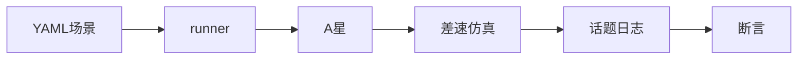

# nav-test

用 YAML 描述导航场景，用 pytest 检查差速机器人有没有到达、有没有撞上、有没有超时。仿真不依赖 ROS，话题日志按 `/odom`、`/cmd_vel`、`/scan` 记录时间戳和频率，克隆后可以直接回归。

YAML navigation scenarios on a 2D differential-drive simulator. pytest checks arrival, collision, timeout, and the rate of odom/scan logs.

## 能做什么

- 三个基础场景：空旷到达、整面障碍阻断、时间预算内到不了
- 栅格 A* 规划，车体按半径膨胀障碍；无路则判为阻断，并且不把车开进障碍
- 每个周期记录 `/odom`、`/cmd_vel`，隔拍记录前方 `/scan` 距离
- 断言场景状态、是否碰撞、里程计频率、时间戳是否单调

## 架构



## 5 分钟跑通

```bash
python3 -m venv .venv
source .venv/bin/activate
pip install -r requirements.txt
pytest
python -m navsim scenarios/reach_goal.yaml
```

## 场景格式

```yaml
name: 空旷到达
timeout_sec: 40
robot_radius_m: 0.2
goal_tolerance_m: 0.4
bounds: {width: 8.0, height: 8.0}
start: {x: 1.0, y: 1.0, yaw: 0.0}
goal: {x: 6.0, y: 6.0}
obstacles: []
expect:
  result: success        # success / blocked / timeout / collision
  collided: false
  odom_hz_min: 15
  scan_hz_min: 8
```

障碍写成轴对齐矩形。`blocked.yaml` 在地图中部放了一整面墙，起点和终点被隔开，期望是 `blocked` 且 `collided: false`。

## 和机器人系统的对应关系

| 本仓库 | 上机器之后 |
| --- | --- |
| `/odom` 的 x、y、yaw | 里程计话题 |
| `/scan` 的前方距离 | 激光雷达在车头方向的量程 |
| `/cmd_vel` | 底盘速度指令 |
| YAML `expect` | 场景通过条件 |
| pytest | 版本回归 |

本仓库解决的是「场景怎么写、失败怎么判」。接到 ROS2 之后，同一套断言改为读真实话题或 rosbag，场景描述可以继续留在 YAML 里。

## 面试时怎么讲

场景表和测试代码分开，新增场景只加 YAML。到达看终点误差，阻断看规划失败且车体没有穿障，超时看预算用完仍在容差外。频率和时间戳是这条回归里的稳定性检查：采样断了，场景结果即使碰巧到达也不算通过。
