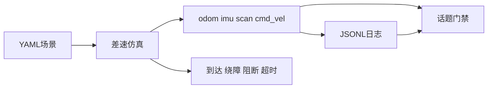

# nav-test

移动机器人导航测试台。用 YAML 写场景，在二维差速仿真里跑导航，再用 pytest 做三层检查：场景结果、传感器话题健康、日志回放。不安装 ROS 也能在本机回归。

A navigation test bench for a differential-drive robot. Scenarios live in YAML. pytest checks the run result, sensor-topic health, and log replay.

## 测什么

- 导航场景：空旷到达、绕行障碍、静态阻断、动态障碍阻断、超时
- 话题：`/odom`、`/imu`、`/scan`、`/cmd_vel` 的频率、帧间隔、时间戳是否回退、激光束数、多话题首帧是否对齐
- 安全边界：不穿过障碍、最小间隙、线速度和角速度上限
- 故障注入：激光丢帧、IMU 时间戳回退、激光束数不对，检查器必须失败
- 日志回放：场景日志写成 JSONL，再按同一套话题规则复检

`/scan` 是正前方 180°、16 束的测距。`/imu` 的角速度来自当前转向指令，用来练话题门禁。

## 架构



## 5 分钟跑通

```bash
python3 -m venv .venv
source .venv/bin/activate
pip install -r requirements.txt
pytest
python -m navsim.suite
```

看单条场景：

```bash
python -m navsim scenarios/detour.yaml
python -m navsim scenarios/dynamic_block.yaml
```

## 场景格式

```yaml
name: 绕行障碍
timeout_sec: 50
robot_radius_m: 0.2
goal_tolerance_m: 0.4
bounds: {width: 8.0, height: 8.0}
start: {x: 1.0, y: 1.0, yaw: 0.0}
goal: {x: 6.5, y: 6.5}
obstacles:
  - {x: 3.0, y: 3.0, w: 2.0, h: 2.0}
motions: []          # 可选，vx/vy 为米每秒
expect:
  result: success    # success / blocked / timeout / collision
  collided: false
  min_clearance_m: 0.0
  health: true       # 按 expectations/topics.yaml 检查四个话题
```

`dynamic_block.yaml` 里障碍从侧面移入通道，规划在相撞前失败，结果是 `blocked` 且 `collided: false`。

## 和机器人系统的对应关系

| 本仓库 | 上机器之后 |
| --- | --- |
| YAML 场景 | 导航场景库 |
| `/odom` | 里程计 |
| `/scan` 的 16 束距离 | 激光雷达在前方扇区的量程 |
| `/imu` | 陀螺仪角速度 |
| `/cmd_vel` | 底盘速度指令 |
| JSONL 回放 | 录包后的回归 |
| `expectations/topics.yaml` | 话题健康门禁 |

仿真负责把场景跑起来。测试断言与仿真解耦：换到 ROS 2 之后，同一份期望改为读真实话题或录包。

## 面试时怎么讲

先讲测试分层，再讲场景。场景层看到达、绕障、阻断、动态障碍和超时。话题层看频率、丢帧、时间戳和激光束数，正常数据必须通过，注入的坏数据必须失败。回放层把同一次运行存成日志再查一遍，避免只在仿真当时看结果。这个仓库练的是导航测试怎么组织，不是 SLAM 或真机标定。
